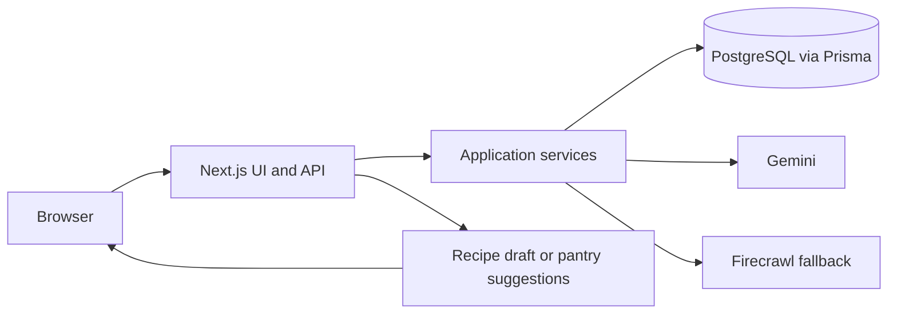

# Pantry

**Cook what you have. Buy what you need. Waste less food.**

Pantry is a personal cooking workspace that connects the food in your kitchen to the recipes you want to make. Keep a recipe collection, track what is on hand, plan meals for the week, and turn the gaps into a grocery list. It is built for the everyday moment when you open the fridge and wonder what to cook before something goes bad.

## Why I built it

I enjoy cooking in my free time, but I kept running into the same problem: I would buy ingredients for a recipe, forget what I already had, and find unused food later. Recipes lived in one place, groceries in another, and the contents of my kitchen mostly in my head.

I built Pantry to make those pieces work together. The goal is simple: make it easier to use the food you have, enjoy cooking, and throw less away.

## What you can do

- **Collect recipes** by writing them yourself or importing from a URL, text, or an image. Review and edit the imported draft before saving it.
- **Keep a kitchen inventory** by adding items manually or taking a photo of your fridge, cabinet, or groceries. Review the suggested items before they enter your pantry.
- **Find a useful next recipe** with recommendations that show which ingredients are already in your pantry, which are on your grocery list, and which are still missing.
- **Plan the week and shop with context** by choosing meals and building an editable grocery list that accounts for pantry stock.

### Where AI fits

AI handles the tedious input work. Pantry uses Google Gemini to turn recipe text or images into structured recipe drafts and to identify visible food in a kitchen photo. For recipe URLs, it first reads the page and uses structured recipe extraction where possible; Firecrawl can provide a markdown fallback for harder pages before Gemini parses the content.

The result is always a **suggestion for you to review** before saving. Ingredient matching, recipe availability, and grocery list calculations live in application code so the planning flow is predictable and editable.

## How it works

Pantry is a Next.js and TypeScript app with a PostgreSQL database. Prisma handles persistence. Recipe and pantry photo imports run within the API request and return a draft for review when processing finishes. The browser keeps the import dialog open during that request. PostgreSQL also stores rate-limit counters and short-lived source image authorization records.



The same database stores accounts, sessions, recipes, pantry items, meal plans, and grocery lists. It retains a successful recipe import record briefly when needed to authorize copying a source image.

## Request beta access

Pantry is available for testing by invitation. Visitors can request access from the sign-in or sign-up page by providing their name, email address, and why they want to try Pantry. Requests are emailed to the configured owner address for manual review. Pantry is in very early testing, and submitting a request does not grant access.

After approving a request, run the following command with `APP_ORIGIN` and the intended deployment database configured:

```bash
pnpm --filter @pantry/web invite:create --email person@example.com
```

The command stores the approved email and prints a single-use sign-up link that expires after seven days. Send that link privately to the applicant. The command does not email them. If the email already has an account, the command approves it for sign-in and no link is needed. Sign-in and existing sessions require an approved email.

For deployment, first apply the new migration to the intended production database, then run `invite:create` for each existing account that should keep access, and only then deploy the gated application. Confirm that the command is connected to the intended database before approving an address. Protect older generated and preview deployment URLs at the Vercel project level so an older deployment with open sign-up and paid import routes cannot be used to bypass the new gate.

Access request delivery requires `RESEND_API_KEY`, `ACCESS_REQUEST_FROM_EMAIL` (a verified sender), and `ACCESS_REQUEST_TO_EMAIL` in the web app's server-side environment. Recipe and pantry AI imports also have a shared limit of 100 attempts per rolling 24 hours by default; set `IMPORT_GLOBAL_DAILY_LIMIT` to adjust it. The existing per-user limit still applies.

If something feels confusing or breaks, I would love to hear about it. Early feedback is helping me make Pantry useful in a real kitchen.

## Run it locally

You will need Node.js 22+, pnpm, and PostgreSQL.

1. Install dependencies with `pnpm install`.
2. Copy [`apps/web/.env.example`](apps/web/.env.example) to `apps/web/.env`. Set `DATABASE_URL` and `DATABASE_URL_UNPOOLED` for PostgreSQL and `GEMINI_API_KEY` for AI imports. Set `FIRECRAWL_API_KEY` if you want the URL import fallback.
3. Apply database migrations with `pnpm --filter @pantry/web exec prisma migrate dev`.
4. Start the app with `pnpm --filter @pantry/web dev`.
5. Open <http://localhost:3000>.

For deployment, run the web app with PostgreSQL and apply migrations before serving traffic. Recipe and pantry imports finish within their requests, so configure the hosting platform to allow the import routes' execution time. Configure `APP_ORIGIN` and `AUTH_CLIENT_IP_HEADER` as described in the environment example.

## Repository map

| Path | What lives there |
| --- | --- |
| [`apps/web/src/app`](apps/web/src/app) | Pages and API route handlers |
| [`apps/web/src/services`](apps/web/src/services) | Recipe, pantry, planning, grocery, and import logic |
| [`apps/web/src/lib`](apps/web/src/lib) | Shared infrastructure and deterministic grocery calculations |
| [`apps/web/prisma`](apps/web/prisma) | PostgreSQL schema and migrations |

Run `pnpm --filter @pantry/web lint`, `pnpm --filter @pantry/web exec tsc --noEmit`, and `pnpm --filter @pantry/web test` to check the app.
