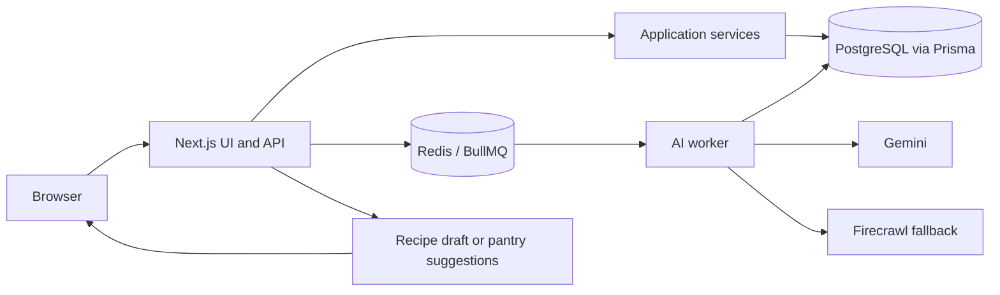

# Pantry

**Cook what you have. Buy what you need. Waste less food.**

Pantry is a personal cooking workspace that connects the food in your kitchen to the recipes you want to make. Keep a recipe collection, track what is on hand, plan meals for the week, and turn the gaps into a grocery list. It is built for the everyday moment when you open the fridge and wonder what to cook before something goes bad.

## Why I built it

I enjoy cooking in my free time, but I kept running into the same problem: I would buy ingredients for a recipe, forget what I already had, and find unused food later. Recipes lived in one place, groceries in another, and the contents of my kitchen mostly in my head.

I built Pantry to make those pieces work together. The goal is simple: make it easier to use the food you have, enjoy cooking, and throw less away.

## What you can do

- **Collect recipes** by writing them yourself or importing from a URL, text, or an image. Review and edit the imported draft before saving it.
- **Keep a kitchen inventory** by adding items manually or taking a photo of your fridge, cabinet, or groceries. Review the suggested items before they enter your pantry.
- **Find a useful next recipe** with recommendations that show which ingredients are already in your pantry, which are on your grocery list, and which are still missing.
- **Plan the week and shop with context** by choosing meals and building an editable grocery list that accounts for pantry stock.

### Where AI fits

AI handles the tedious input work. Pantry uses Google Gemini to turn recipe text or images into structured recipe drafts and to identify visible food in a kitchen photo. For recipe URLs, it first reads the page and uses structured recipe extraction where possible; Firecrawl can provide a markdown fallback for harder pages before Gemini parses the content.

The result is always a **suggestion for you to review** before saving. Ingredient matching, recipe availability, and grocery list calculations live in application code so the planning flow is predictable and editable.

## How it works

Pantry is a Next.js and TypeScript app with a PostgreSQL database. Prisma handles persistence. Recipe and pantry photo imports run as background jobs: the API records a job in PostgreSQL, places it on a BullMQ queue in Redis, and returns immediately. A separate worker processes the job, writes its progress and result back to PostgreSQL, and the app displays the draft for review. This keeps slow external API calls out of the normal request path.

The same database stores accounts, sessions, recipes, pantry items, meal plans, grocery lists, and import job state. The worker handles recipe imports and pantry image extraction; regular planning and list operations run through the app's API and services.

## Request beta access

Pantry is available for testing by invitation. [Email me](mailto:kunaldk98@gmail.com?subject=Pantry%20beta%20access) with the email address you would like to use and a short note that you want to try Pantry. I will add your email to the allowed list and send you the app URL. Once you have access, you can create your own account and try it with your recipes and pantry.

If something feels confusing or breaks, I would love to hear about it. Early feedback is helping me make Pantry useful in a real kitchen.

## Run it locally

You will need Node.js 22+, pnpm, PostgreSQL, and Redis. The repository's [`docker-compose.yml`](docker-compose.yml) starts a local Redis instance.

1. Install dependencies with `pnpm install`.
2. Copy [`apps/web/.env.example`](apps/web/.env.example) to `apps/web/.env`. Set `DATABASE_URL` and `DATABASE_URL_UNPOOLED` for PostgreSQL, `REDIS_URL` for Redis, and `GEMINI_API_KEY` for AI imports. Set `FIRECRAWL_API_KEY` if you want the URL import fallback.
3. Start Redis with `docker compose up -d redis` and apply database migrations with `pnpm --filter @pantry/web exec prisma migrate dev`.
4. Start the app with `pnpm --filter @pantry/web dev` and, in another terminal, start the worker with `pnpm --filter @pantry/web worker:ai`.
5. Open <http://localhost:3000>.

For deployment, run the web app and worker as separate processes connected to the same PostgreSQL database and Redis instance. Configure `APP_ORIGIN` and `AUTH_CLIENT_IP_HEADER` as described in the environment example.

## Repository map

| Path | What lives there |
| --- | --- |
| [`apps/web/src/app`](apps/web/src/app) | Pages and API route handlers |
| [`apps/web/src/services`](apps/web/src/services) | Recipe, pantry, planning, grocery, and import logic |
| [`apps/web/src/workers`](apps/web/src/workers) | BullMQ worker for AI imports |
| [`apps/web/src/lib`](apps/web/src/lib) | Shared infrastructure and deterministic grocery calculations |
| [`apps/web/prisma`](apps/web/prisma) | PostgreSQL schema and migrations |

Run `pnpm --filter @pantry/web lint`, `pnpm --filter @pantry/web exec tsc --noEmit`, and `pnpm --filter @pantry/web test` to check the app.
